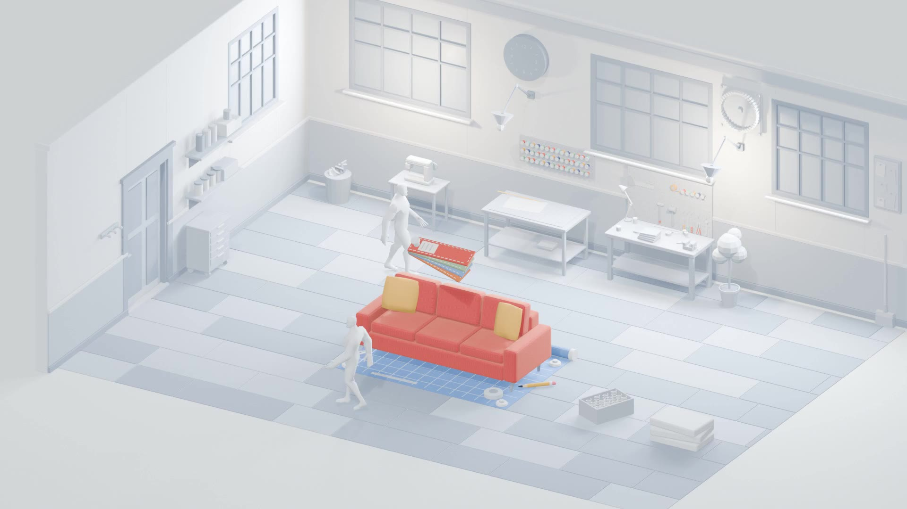

<p align="center">
  
</p>

<h1 align="center">Vorta</h1>
<p align="center"><b>Everything behind a physical product. In one place.</b><br>
A sofa gets designed, sold, built, boxed and shipped. You scroll. It happens.</p>

---

## The trick

The hero is a single pre-rendered Blender shot: one static camera, one room, one sofa, 43 seconds of story.
Nothing is a 3D scene in the browser. It is a video that **your scroll position drives frame by frame**.

**workshop → blueprint → swatches → wall falls → warehouse → box → forklift → truck leaves**

- Plays itself once. Scroll down to speed it up, scroll up to rewind it. The banner only shows up once the story ends.
- Page position *is* the frame, so letting it play and scrolling it by hand land on the same spot.
- It loads adaptively: 1080p / 720p / 480p picked from real throughput, with a poster fallback if video can't play.
- No widows. Ever. Not a single lonely word on a last line.

## Run it

```bash
npm ci
npm run dev      # http://127.0.0.1:3000
npm run build    # static site in dist/, host it anywhere
```

Stack: Vite, GSAP, Tailwind. No backend, no keys, no drama.

## Where things live

| | |
|---|---|
| `src/story.js` | the frame-scrubbing engine, loader, dust, adaptive tiers |
| `src/ui.js` | stepper, banner, scroll-to-frame sync, fast-forward |
| `src/widows.js` | the no-lonely-words rule |
| `public/assets/story/` | the renders (`story_1080/720/480.mp4`, `poster.jpg`) |
| `docs/WEB_NOTES.md` | notes from the earlier truck-and-city version |

## The truck era

The first version was a low-poly city with a delivery truck, built in three.js with baked lightmaps.
It lives on in the [`truck-v4`](../../tree/truck-v4) branch.

## Re-rendering

Edit the shot in Blender, render to `renders/seq3`, encode with ffmpeg (`-g 4 -bf 0` so scrubbing stays snappy),
drop the files into `public/assets/story/`. The camera is static on purpose: the SVG overlays and dust are
pinned to it.
